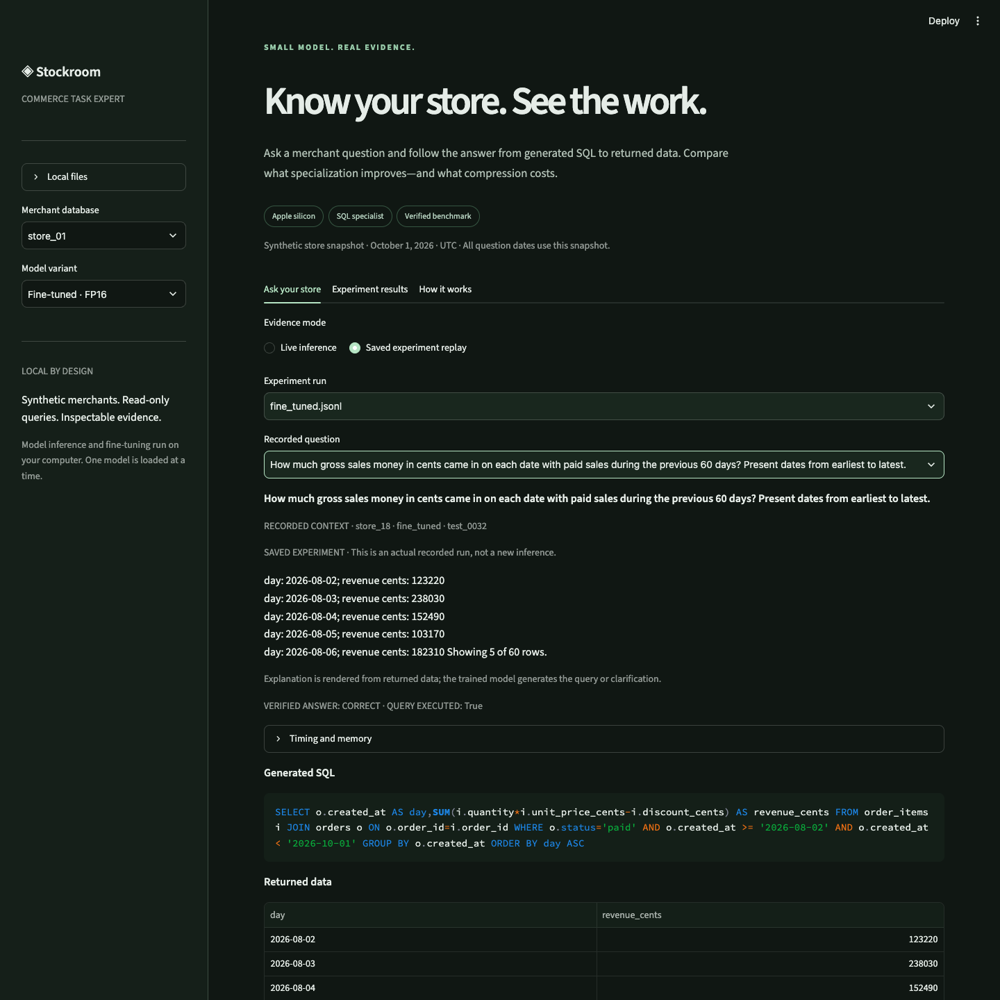

# Commerce Task Expert

A small local model that turns merchant questions into executable SQL, checks the returned evidence, and presents the result. The project compares an original open model, a locally fine-tuned model, and its 4-bit version on exactly the same held-out questions.

Built for an **Apple M4 MacBook Pro with 16 GB unified memory**. Training and inference use the local GPU. No hosted model API, merchant account, cloud GPU, or paid teacher is required.

> **Research question:** Can supervised fine-tuning make a small commerce SQL specialist more accurate, and how much of that improvement survives quantization?

**Measured status:** the 60-case pilot produced **0/60** correct answers for the original model, **8/60** for fine-tuned FP16, and **6/60** for quantized fine-tuned. Improvements were confined to familiar patterns on unseen stores; held-out compositions and clarification remained unsolved. This is a reproducible research prototype with documented model limitations.

## What is included

- 20 reproducible merchant databases: products, variants, inventory, orders, order lines and partial returns.
- 2,000 training, 160 validation and 240 test questions with independently verified reference answers.
- Explicit tests for unseen stores, unseen SQL compositions, both shifts together, and ambiguity.
- Qwen2.5-Coder-1.5B-Instruct, FP16 LoRA training, fused FP16 checkpoint, and MLX 4-bit quantization.
- First-attempt answer correctness, query execution, latency, token counts and MLX memory measurements.
- A local **Stockroom** demo showing the question, generated SQL, returned rows, assumptions and grounded evidence.

The demo's explanation is a deterministic rendering of query results. The learned component produces a query or asks for clarification. Stockout estimates use recent sales velocity; they are not calibrated probabilities.



## Quick start

Install [uv](https://docs.astral.sh/uv/), clone the repository and run from its root:

```sh
git clone https://github.com/athravseruwam07/commerce-task-expert.git
cd commerce-task-expert
uv sync --extra dev --locked
uv run commerce generate
uv run pytest -q
uv run streamlit run app.py
```

The demo opens at http://localhost:8501. Experiment replay reads the checked-in **actual recorded runs**, so it works without model downloads. Live inference requires the local weights described below. A clean clone regenerates stores with identical seeds and frozen dates.

## Reproduce the model experiment on Apple silicon

```sh
uv sync --extra ml --extra dev --locked
uv run python scripts/train_local.py --iters 300 --max-seq-length 1024
uv run python scripts/quantize_local.py
uv run commerce evaluate base --limit 60
uv run commerce evaluate fine_tuned --limit 60
uv run commerce evaluate quantized --limit 60
uv run python scripts/analyze_results.py
```

For the same sequence in one command, use `uv run --extra ml python scripts/run_experiment.py`. Add `--skip-training` to reuse checkpoints or `--full` to write the complete 240-case comparison under `reports/full`.

Each evaluation is a separate process. Use the **same limit and token cap for all three**. The 60-case pilot is deterministically balanced across the four test slices and cycles through each slice's patterns. To evaluate the entire 240-case benchmark, omit `--limit 60` for all three runs and write them to a separate `--reports-dir reports/full` to preserve the published pilot. Do not tune on either test run. The complete baseline / fine-tune / quantization workflow is in [training documentation](docs/TRAINING.md).

```sh
uv run commerce ask "Which variants will run out within 7 days based on paid unit sales during the last 14 days?" --store store_17 --variant quantized
```

## Use the released adapter without retraining

The private GitHub release contains the selected adapter and checksums, not multi-gigabyte model weights. With GitHub CLI authenticated to this repository:

```sh
mkdir -p work
gh release download v0.1.0 --pattern commerce-adapter-v1.tar.gz --dir work
uv sync --extra ml --extra dev --locked
uv run commerce generate
uv run python scripts/restore_adapter.py work/commerce-adapter-v1.tar.gz
uv run streamlit run app.py
```

Restoration downloads the exact pinned public base revision if needed, verifies adapter checksums, fuses locally, and creates the 4-bit model. It leaves the published training report intact. Model files remain ignored by Git.

## Results and interpretation

Measured runs are saved in [reports](reports/) with one raw record per question, SQL, returned rows, expected rows, correctness, timing and errors. [RESULTS.md](reports/RESULTS.md) is generated from these records; [summary.json](reports/summary.json) contains machine-readable aggregates. Training and quantization metadata record configuration, dataset hashes, source revision, package versions and model sizes. The training search ran 300 batch-size-1 updates (about 0.15 epoch); validation selected the checkpoint at update 200 (about 0.10 epoch).

| Variant | Correct / 60 | Median generation | Peak MLX memory |
|---|---:|---:|---:|
| Original FP16 | 0 | 6.82 s | 3.29 GB |
| Fine-tuned FP16 | 8 | 5.07 s | 3.29 GB |
| Quantized fine-tuned | 6 | 2.05 s | 1.31 GB |

The fine-tuned model scored **53.3%** on familiar patterns with unseen stores and **0%** on both held-out-composition slices. Quantization reduced peak MLX allocations by about **60%**, while losing two correct answers. Low validation completion loss did not establish reliable free-generated SQL. Further improvement requires a stronger training/validation protocol and a fresh final test cohort; the published test results are kept unchanged.

**Execution success alone is not correctness.** A valid SQL query can use the wrong dates, double-count joins, omit cancelled-order filtering, or confuse product and variant aggregation. Scoring compares actual results with independently computed expected rows, including ordering, ties, and numeric tolerance. A single global column permutation allows equivalent aliases and column order without exposing expected output columns to the model.

All stores share one schema. Unseen-store results therefore demonstrate transfer across data distributions, not arbitrary schema generalization. A finite set of synthetic patterns and one training seed limit broader claims. Clarification accuracy measures the query-versus-clarify decision; useful clarification wording additionally needs human review.

## Business semantics

- Fixed as-of date: **2026-10-01**, exclusive. Last 7 days means `[2026-09-24, 2026-10-01)` in UTC.
- Paid orders count; cancelled orders do not. All monetary results use integer cents.
- Available inventory is on-hand minus reserved. Restocked returns are already in the inventory snapshot.
- Stockout risk: positive recent demand and available units below recent paid units / lookback days × horizon days.
- Return/refund aggregation is at order-line level before joining to sales to avoid join fan-out.
- Missing essential metric or period prompts clarification when the documented policy cannot resolve it.

Concrete observed failures and scoring caveats are examined in [failure analysis](docs/FAILURES.md).

See [dataset design](docs/DATASET.md), [end-to-end plan](docs/PLAN.md), and [demo guide](docs/DEMO.md).

## Repository map

```text
commerce_expert/   database, oracle benchmark, SQL execution, inference, evaluation, CLI
configs/          recorded LoRA training configuration
scripts/          local training, fusion, quantization, result analysis
app.py            Streamlit demo: live inference + actual-run replay
reports/          measured results, raw per-case records, metadata
models/           ignored local base / adapters / fine_tuned / quantized weights
data/generated/   ignored reproducible SQLite stores and JSONL corpus
tests/            oracle, split, SQL guardrail, scoring, prompt and UI tests
```

Queries run against a read-only SQLite connection with an authorizer, single-query validation, a time budget, and a result cap. This is a local research application, not a production multi-tenant query service.

## Inspiration and attribution

Inspired by Shopify's [open-model task expert engineering workflow](https://shopify.engineering/open-model-task-experts): define quality, evaluate failures, train specialists, and measure serving efficiency. This independent project uses SQL and a smaller local experiment; it does not reproduce Shopify's production system or its reported performance.

Model: [Qwen2.5-Coder-1.5B-Instruct](https://huggingface.co/Qwen/Qwen2.5-Coder-1.5B-Instruct), Apache 2.0. Runtime: [MLX LM](https://github.com/ml-explore/mlx-lm), MIT. Original project code: MIT, see [LICENSE](LICENSE).
